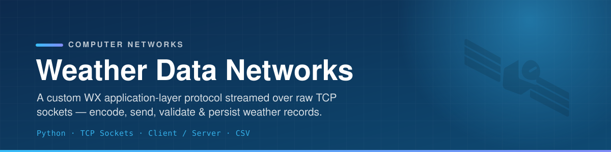
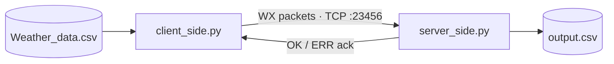

<p align="center">
  
</p>

<p align="center">
  
  
  
  
</p>

<p align="center">
  A client–server application that defines its own <b>WX application-layer protocol</b> over raw TCP.
  The client encodes a large weather-station dataset into WX packets and streams them; the<br>
  server validates each packet, acknowledges it, and persists accepted records to CSV.
</p>

<p align="center">
  <i>ECE 3325 — Computer Networks, Texas Tech University</i>
</p>

---

## ✨ What it does

- 📡 **Custom WX protocol** — a newline-terminated application-layer format over raw TCP sockets.
- 🧾 **CSV → packet encoding** — the client reads each weather record and encodes it, skipping
  incomplete or malformed rows.
- ✅ **Server-side validation** — the server parses every packet, replies `OK` / `ERR`, and writes
  valid records to `output.csv`.
- 🔁 **Stop-and-wait streaming** — the client waits for each acknowledgment before sending the next
  record, then prints a delivered-vs-skipped summary.
- ⌨️ **Interactive command loop** — after transmission the client stays connected for commands
  (e.g. `QUIT`).

## 📦 WX packet format

```text
WX|StationID|Date|Temperature|Condition\n
```

Server replies `OK\n` for a valid packet, `ERR\n` for an invalid one.

## 🏗 Architecture



## 🗂 Project structure

```text
├── server_side.py      # TCP server — listens, validates, writes output.csv
├── client_side.py      # TCP client — reads CSV, encodes + streams WX packets
└── data/
    └── README_data.md  # Notes on the data files (excluded from the repo)
```

## 🚀 Setup & run

Python 3.x, standard library only — no packages to install. Place `Weather_data.csv` in the
project root (see [`data/README_data.md`](data/README_data.md)).

```bash
# Terminal 1 — start the server first (listens on :23456, writes output.csv)
python server_side.py

# Terminal 2 — run the client against the server's IP
python client_side.py 127.0.0.1
```

## 🧰 Stack

| Layer | Tech |
| ----- | ---- |
| Language | Python 3 (standard library only) |
| Transport | Raw TCP sockets |
| Protocol | Custom WX application-layer format |
| Persistence | CSV (`output.csv`) |
